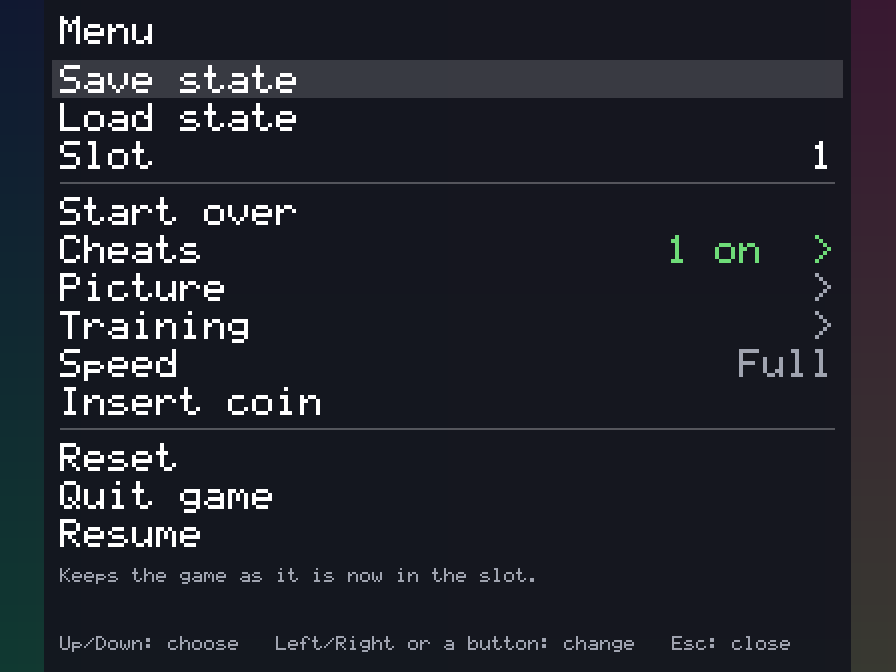
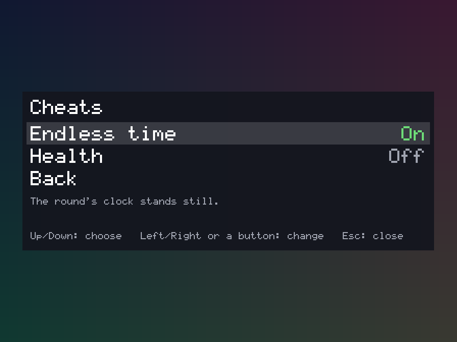
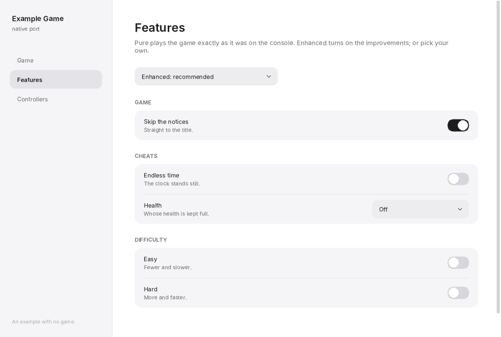

# recomp-common

[](https://github.com/tmcleroy/recomp-common/actions/workflows/ci.yml)
[](https://github.com/tmcleroy/recomp-common/releases)
[](LICENSE)

Code shared between recomp ports (native ports of games made by static recompilation): an
**in-game overlay menu** and the small bitmap text it is drawn with, the **settings rules** a
launcher and its game must agree on, and the **launcher** itself.



The menu knows nothing about any game, console or windowing library. A port tells it what rows to
show, hands it button presses, and gets back what the player chose; it draws itself into a buffer of
32-bit pixels over a copy of the game's picture. The same menu, with the same look and rules, then
works in every port that takes it.

- `src/` is C++17 with no dependencies beyond the standard library. No SDL.
- C interfaces (`menu_c.h`, `settings_c.h`) for ports written in C.
- `launcher/` is a program of its own (SDL 3 and Dear ImGui, fetched by its build).
- Nothing from any game is in this repository, and nothing from a game is needed to build or test it.

## Who uses it

| Project | What |
| --- | --- |
| [cps2recomp](https://github.com/tmcleroy/cps2recomp) | A toolkit for native ports of Capcom CPS-2 arcade games; keeps a copy in `recomp-common/` |
| [satrecomp](https://github.com/tmcleroy/satrecomp) | A toolkit for native ports of Sega Saturn games; keeps a copy in `recomp-common/` |
| [Vampire Savior Recomp](https://github.com/tmcleroy/vampire-savior-recomp) | A native port of *Vampire Savior* (CPS-2) with a full training mode, made with cps2recomp: the menu and launcher you see there are this library's ([download](https://github.com/tmcleroy/vampire-savior-recomp/releases)) |

To play a game, download a port; this repository is for people making ports.

## What the menu does

- A first page in groups with a line between them: save states (save, load, a slot from 1 to 9),
  what the game offers (the port's own rows, the game's speed, slower or faster than full, a row for each
  page of optional features), and leaving (reset, quit, resume).
- A page per category of the game's optional features (cheats, training aids, picture options) and
  commands, built from one list the port hands over. A feature is on or off, or a choice of several
  named things.
- A description of the chosen row, a line for messages ("Nothing is kept in slot 3."), and a hint
  line naming the buttons as this console calls them.
- Six buttons: up, down, left, right, confirm, back. The port maps its own onto them.
- Any picture size: sizes follow the picture's height, and where the rows do not all fit, the ones
  about the chosen row are shown.



## The launcher



One launcher for every port: a Game page (the player's own game file, which is only ever read; the
picture's options; the sound's, with folders the port lets the player choose, such as a custom soundtrack's; Play; and, for a port with online play, an Online card: Host, with the addresses this machine can be joined at, and Join, with the host's address, or the code the host's game shows for a game that gives one; and for a game with a lobby, a switch to list the matches you host under your name, and the open matches other players have listed, to join with a press), a Features page (the presets Pure, Enhanced and Custom, a search box, and a switch or
a choice for each feature the game lists; for a long choice the game marks `kFeatureMenuChoices`, which of its
choices the game's own menu goes through, so the player's favourites make a short list there), and a Controllers page (connected gamepads, a tester, and a
key and a gamepad button for each of the game's buttons, for each of its players, up to four). All of it can be used with a gamepad alone,
or the arrow keys with Space or Enter, as well as with the mouse. A port adds one file that describes
itself: the words for its game file and the check of it, what the game is started with, which
buttons can be chosen. A port that is not about one game file can add pages of its own and leave
the Game page out. The launcher and the game read and write the same `settings.ini` by the same
rules (`src/settings.h`), so they cannot disagree about what a line in it means.

**A collection**: one launcher for several games, each a program of its own beside it (a toolkit's ports, say;
`LAUNCHER_COLLECTION` and `launcher::describe_collection()` in `launcher/src/launcher.h`). Its Games page finds
each game's file in a folder the player chooses (or one dropped on the window) and has Play beside each; its
Features page has the features more than one game has, under the same name and with the same choices, set for
all of them at once (a game marks one of its own that only shares a name: `kFeatureOwn`), and a feature changed
in a game's own menu is set for the others when it ends; its Controllers page sets the keys and buttons of every
game, or a game's own layout for a game given one (`Collection::bindings` is every game's table, a game's
`Description::bindings` its own, with its own names for its buttons); and each game whose file is chosen has a page with its Display switches, Play, and the features only it
has. The player puts the games in their own order by dragging a game's row in the sidebar (or with Move up and Move
down on its page; kept in `launcher.ini`), and the Games page lists them the same way. For a player who has only one or two of the games, **Only the games you have** (a switch on the Games page, once one game is set up; `launcher.ini` `[games] installed_only`) leaves the others out of the Games, Features and Controllers pages; Choose folder… still finds them. Its games can run at once, one of each, and a game that needs another's file too is given the one chosen on that game's page (`Launch::file_of`). Every game keeps its own folder and a complete `settings.ini`, as a launcher of its own would, and takes
over the file chosen there. `--play ID` starts a game straight away, `--play ID -- ARGS` gives the game more
arguments after the launcher's own, and `--page ID` opens at a game's page. A collection may have modes that play
several of its games one after another (`Collection::multi`, `MultiMode`): a Multi game page where the player chooses
which games, in the sidebar's order or shuffled, and the mode's own choices; Start starts each in turn with the mode's
arguments, and a game that ends with the mode's exit code (`next_code`) has had its turn, so the next one starts (after
the last, the first again); quitting one stops the run. A mode can name the keys and buttons that work while its games play (`MultiButton`), shown on its card and while it plays. `--page multi` opens there. A collection with online play's lobby (`Collection::lobby`) has an Online page after it: the player's name, a match to host in the lobby in any of the games, the features about a match (`Collection::online_features`), and every game's open matches, each with Join; a match in a game whose file isn't chosen yet is greyed, with Add… to its page, and one in a game the collection hasn't is greyed under the game's name, with Update… (`--page online`). A port's own launcher is unchanged:
its pages are the same pixels as before.

**Updates** (optional: `LAUNCHER_UPDATE_REPO` and `LAUNCHER_VERSION` in the port's `launcher/CMakeLists.txt`;
`launcher/src/update.h`): the launcher looks at the port's GitHub releases when it opens (a switch turns that
off) and, when there is a newer version, offers it at the top of its first page. Update downloads that system's
archive from the release (the same file a player downloads by hand), checks it against the manifest the port's
release script puts beside it, unpacks it, checks every file that changed, and only then puts them in place,
taking away the files the new version no longer has; if anything fails nothing is changed. Then the new launcher
starts. A release so carries only its archives and one small manifest per system. A copy that is not a release's
download (a build) is only told of the new version. Downloads go through the system's `curl`, unpacking through
its `tar` (`ditto` on macOS).

**Portable mode** (`src/folders.h`): a file named `portable.txt` beside the launcher (on macOS beside the app,
which is never written to; beside the AppImage for one) keeps the player's folders, settings, saves and logs, in
`user/<name>/` there instead of the system's folder for them, so the whole thing can be carried on a drive. The
first time, the launcher offers to copy what the system's folders have (it never moves or writes over anything);
a folder it cannot write to is said, and it stops rather than keep things elsewhere. Taking `portable.txt` away
goes back to the system's folders as they were. Updates keep `portable.txt` and `user/`: they are not a release's
files. The first page's Your files card shows the folder and opens it. A port's game that finds the launcher's
`launcher.ini` itself asks `recomp::PortableFolder` too.

Its look, and the files that make it, come from the launcher of
[wiiparty-recomp](https://github.com/arelkair/wiiparty-recomp) by arelkair; see
[THIRD_PARTY_NOTICES.md](THIRD_PARTY_NOTICES.md).

## Try it

```sh
make test       # the menu's rules, and the C interface compiled as C
make example    # build/shot: a host with no game
build/shot menu.ppm ddddar     # press Down x4, Confirm, Right; write the picture
```

`examples/shot.cpp` is a complete host in about a hundred lines and is the place to start reading.

```sh
make launcher   # build/launcher/example-launcher, with a stand-in for the game (needs cmake; SDL 3 is fetched if absent)
make launcher-shots            # its three pages as pictures, with no window shown
```

`launcher/example` is what a port's own launcher folder looks like.

## Using it in a port

The library is not installed and has no package: a port keeps a **committed copy** of `src/` and
`launcher/` and compiles it with the rest of its code, so the port builds from a fresh clone with nothing else
present. `tools/sync-common.sh` makes the copy, records which commit it came from, and (with
`--check`) fails if anyone changed the copy by hand.

[docs/USING.md](docs/USING.md) has the steps, the interface in full, and the rules a port is
expected to follow (what opens the menu, what "Quit game" means, the order of the first page).

| File | What |
|---|---|
| `src/menu.h`, `menu.cpp` | The menu. |
| `src/menu_c.h`, `menu_c.cpp` | The same menu for hosts written in C. |
| `src/settings.h`, `settings.cpp` | The settings file and the rules for features: presets, values, choices. |
| `src/settings_c.h`, `settings_c.cpp` | The same rules for hosts written in C. |
| `src/folders.h` | Where the player's things are: the folder a download was unpacked to, and portable mode. |
| `launcher/` | The launcher: `launcher.cmake` (what a port includes), `src/` (`launcher.h` is what a port fills in), `example/`. |
| `src/text.h` | A 5x7 dot-matrix font on a canvas of 32-bit pixels; usable on its own for a port's readouts. |
| `tools/sync-common.sh` | The script a port keeps to take and check its copy. |
| `examples/shot.cpp` | A host with no game. |
| `tests/` | `make test`. |

## Status

Version 0.5.0 (see [CHANGELOG.md](CHANGELOG.md)). The interface may still change before 1.0; a
port is never changed under its feet, because it only moves to a new version when it runs the sync
script.

## Contributing

Bug reports and pull requests are welcome: see [CONTRIBUTING.md](CONTRIBUTING.md). The one hard
rule: nothing from any game, and no keys, ever go in this repository.

## License

[GNU General Public License v3.0](LICENSE) (`GPL-3.0-only`). A project that includes the copy must
itself be distributed under terms compatible with it, keep the notices at the top of the files, and
ship the license text. [THIRD_PARTY_NOTICES.md](THIRD_PARTY_NOTICES.md) says where everything came
from.
